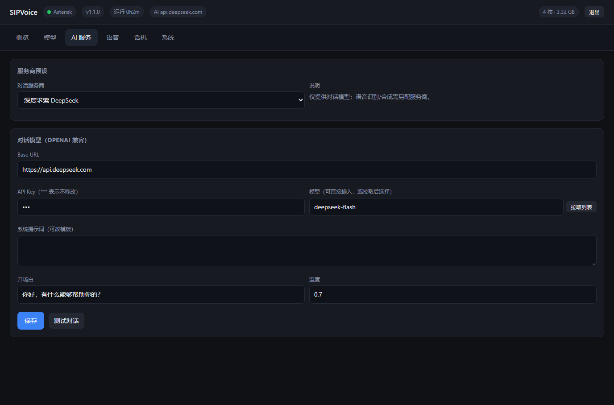
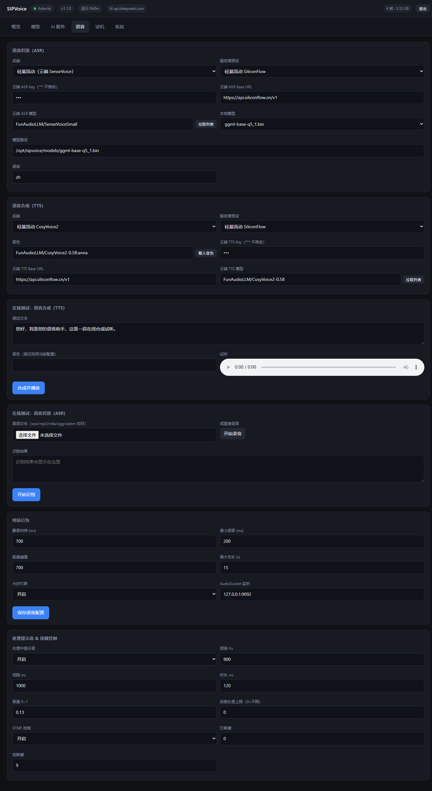

# SIPVoice · Lightweight SIP Voice AI Gateway


**English** · [简体中文](README.zh-CN.md)

Turn an ordinary phone call into a conversation with an AI assistant:
**phone / voice gateway → Asterisk → voicebridge → any LLM**.
No public IP, no vendor cloud, no monthly platform fee — a single Go binary that runs on a 2-core box.

> ⚠️ **Alpha software — please read before using**
>
> - This project was written **100% by AI** (an AI coding agent under human direction). It has been
>   tested on real hardware and real phone calls, but it has **not** been reviewed line by line by a
>   human maintainer.
> - It is at an **early stage** (v1.x): interfaces, configuration keys and deployment scripts may
>   change without notice.
> - **Do not use it in production**, in any life-safety context, or where a dropped call or a wrong
>   answer could cause harm. Evaluate it in a lab or at home first.
> - Provided **as is**, without warranty of any kind. You are responsible for the phone numbers,
>   credentials and AI usage costs you connect to it.

---

## What it does

- ☎️ **AI answers your phone**: dial `9000`, the AI picks up, listens, replies, can be interrupted
- 🎙️ **Two voice pipelines**
  - Pipeline: cloud/local ASR → chat model → TTS (each part can be a different provider)
  - End-to-end: Qwen-Omni-Realtime over WebSocket — audio in, audio out, **first response ≈ 0.5 s**
- 🖥️ **Web console**: provider presets, live model list, TTS preview, ASR upload/record test,
  phone extension inventory, system monitor
- 🔔 **Alerts**: ServerChan push to WeChat (startup / cloud errors / low disk)
- 📠 Fax send/receive (T.38 / G.711, saved as TIFF, PDF convertible)

## Architecture

```
 ┌────────────┐   SIP/RTP    ┌───────────┐   AudioSocket   ┌──────────────┐
 │ phone /    │ ───────────► │ Asterisk  │ ──────────────► │ voicebridge  │
 │ FXS gateway│ ◄─────────── │    22     │ ◄────────────── │ (Go, 1 file) │
 └────────────┘              └───────────┘   PCMU 20 ms    └──────┬───────┘
                                                                  │ HTTPS / WSS
                                                         ┌────────▼────────┐
                                                         │ ASR / LLM / TTS │
                                                         │ or end-to-end   │
                                                         └─────────────────┘
```

- **Asterisk** handles SIP signalling, G.711 codecs and fax
- **voicebridge** handles VAD segmentation, barge-in, DTMF, AI calls and the web console
- Audio flows over **AudioSocket** (TCP) between them — no external media service

## Requirements

- Ubuntu 22.04 / 24.04 / 26.04 or Debian 12+ (systemd)
- 2 CPU cores, 2 GB RAM, ~2 GB disk
- Network access to your chosen AI provider (and to apt for the dependencies)
- Optional: a SIP phone (MicroSIP, Zoiper, a real desk phone) or an FXS gateway

## Quick start

```bash
# 1. get a release package (or build it yourself, see below)
scp sipvoice-<version>-linux-amd64.tar.gz user@host:/tmp/
ssh user@host
tar -xzf /tmp/sipvoice-<version>-linux-amd64.tar.gz
cd sipvoice-<version>

# 2. one command install (installs asterisk / ffmpeg / curl for you)
sudo bash install.sh

# 3. open the console, create the admin account, add your provider key
#    https://<host-ip>:8080
```

Then dial:

| Number | Purpose |
|---|---|
| `9000` | Talk to the AI |
| `600` | Receive a fax |
| `1001` / `1002` | Test extensions (passwords `SipVoice1001` / `SipVoice1002`) |

> Change the default extension passwords right after the first login (Console → Phones).

## Screenshots

| AI providers | Voice & online tests |
|---|---|
|  |  |

## Configuration

Everything is editable in the console; changes are written to `/etc/sipvoice/config.json` and applied
without a restart.

- **Providers**: DeepSeek, SiliconFlow, Alibaba DashScope, OpenAI, Groq, Zhipu, Moonshot, Tencent
  Hunyuan, Volcano Ark, local Ollama, custom OpenAI-compatible endpoints
- **Models**: type a name, or click *Fetch list* to query the provider with your key
- **End-to-end voice**: `realtime.enabled`, default `qwen3.5-omni-flash-realtime`
- **Conversation**: silence timeout, energy threshold, max utterance, barge-in, processing tone
- **DTMF**: `0` interrupts playback, `9` hangs up (both configurable)

A minimal config file looks like this:
```json
{
  "audio": { "listen": "127.0.0.1:9092" },
  "ai": {
    "base_url": "https://api.deepseek.com/v1",
    "api_key": "sk-...",
    "chat_model": "deepseek-flash",
    "asr_backend": "siliconflow",
    "tts_backend": "siliconflow"
  },
  "realtime": { "enabled": false },
  "agent": { "greeting": "Hello, how can I help you?" }
}
```

### Changing the console port (manual)

The console listens on `0.0.0.0:8080`, set by the `-web` flag in the systemd unit. There is no field
for it in the console yet. Override it with a drop-in (this survives `install.sh`, which only
rewrites the main unit file):

```bash
sudo mkdir -p /etc/systemd/system/sipvoice.service.d
sudo tee /etc/systemd/system/sipvoice.service.d/web-port.conf >/dev/null <<'EOF'
[Service]
ExecStart=
ExecStart=/opt/sipvoice/voicebridge -mode agent -config /etc/sipvoice/config.json -web 0.0.0.0:9080
EOF
sudo systemctl daemon-reload
sudo systemctl restart sipvoice
```

Notes:

- only the console port changes; SIP (`5060/udp`) and AudioSocket (`127.0.0.1:9092`) are unaffected
- the TLS certificate is bound to the host name, not the port — no need to regenerate it
- open the new port in your firewall if you had one for 8080

## Package (.deb)

For Ubuntu / Debian. The `.deb` declares all dependencies — **install it with apt**
(`dpkg -i` aborts when dependencies are missing and needs `apt install -f` afterwards):

```bash
# recommended: apt resolves dependencies
sudo apt install ./sipvoice_2.0.3_amd64.deb

# or install dependencies first, then dpkg
sudo apt install -y asterisk asterisk-config ffmpeg curl ca-certificates sudo \
    uuid-runtime libtiff-tools imagemagick ghostscript paps fonts-noto-cjk
sudo dpkg -i sipvoice_2.0.3_amd64.deb
```

After installing:

- the `sipvoice` service is registered and enabled, console at `https://<host-ip>:8080`
  (create the admin account on first visit)
- config lives in `/etc/sipvoice/`; uninstall with `sudo apt purge sipvoice`
  (`apt remove` keeps the config)
- recordings go to `/var/lib/sipvoice/recordings` when there is no separate data disk,
  and the cleanup timer is enabled automatically

## Docker

A single image contains Asterisk + voicebridge. **Host networking is strongly recommended** — SIP and
RTP behind Docker's NAT need extra tuning.

```bash
docker run -d --name sipvoice --restart unless-stopped --network host \
  -v sipvoice-etc:/etc/sipvoice \
  -v sipvoice-models:/opt/sipvoice/models \
  ghcr.io/USER/sipvoice:latest
```

Then open `https://<host-ip>:8080` and create the admin account.

Build it yourself:

```bash
make linux-amd64
docker build -t sipvoice:1.3.0 .
# 国内网络可加：--build-arg APT_MIRROR=cn.archive.ubuntu.com
```

If you cannot use host networking, publish the ports (Asterisk may need NAT settings adjusted):

```bash
docker run -d --name sipvoice \
  -p 5060:5060/udp -p 10000-10100:10000-10100/udp -p 8080:8080 \
  -v sipvoice-etc:/etc/sipvoice sipvoice:1.3.0
```

| Volume | Purpose |
|---|---|
| `/etc/sipvoice` | configuration, API keys, admin account, phone inventory, TLS certificate |
| `/opt/sipvoice/models` | optional local whisper models |

`SIPVOICE_WEB` overrides the console bind address (default `0.0.0.0:8080`). See
[docs/DOCKER.md](docs/DOCKER.md) for details and troubleshooting.

## Fax

The **Fax** tab covers sending and receiving end to end.

**Receive** — dial **600**. T.38 (UDPTL 4000-4999) with G.711 fallback. Faxes land in
/var/spool/asterisk/fax and can be previewed page by page or downloaded from the console.

**Send** — pick an archived fax, enter a destination extension, and the server calls out and
sends it. A **pre-generated voice prompt** plays first (synthesised once, reused forever, so
no repeated TTS billing):

> 感谢接听，这是 AI 下发的传真服务。请按传真机上的开始键接收。如果无法接收，请按 4 结束。

After the prompt the server waits (configurable, default 30 s). Pressing **4** marks the
delivery as "recipient cannot receive fax".

**Failures** — rejected, unreachable, or failed-handshake faxes are archived under
/var/lib/sipvoice/fax-failed and emailed with an automatically converted **PDF** attachment.
Each extension can carry its own mailbox; otherwise the global default is used.

**Mail** — built-in Go SMTP client (no msmtp/sendmail needed), SSL 465 and STARTTLS 587 with
automatic fallback, primary + backup provider, and a one-click "send test mail" button.
## Storage & logs

The **Storage** tab in the console controls all of this — no server access needed:

| Setting | Meaning |
|---|---|
| Call recording | on/off; when off, extension 9000 stops recording |
| Recording directory | where recordings go (default /data/recordings/monitor) |
| Recording quota | default **5 GB**; every 5 minutes the oldest files are deleted until usage drops below 90% |
| Log size limit | default **50 MB** per file |
| Log files kept | default 5, compressed |

The page also shows current usage (file count/size, log size, free disk) and offers
**Clean now** / **Rotate now** buttons.

Under the hood the console stores the switch and path in Asterisk's AstDB
(sipvoice/rec, sipvoice/rec_dir), which the dialplan reads per call, and writes the
quota/rotation rules to /etc/default/sipvoice-rec and /etc/logrotate.d/asterisk.
Without a separate data disk, recordings live under /var/lib/sipvoice/recordings.
## Upgrading from 1.x

2.0 brings four breaking changes — read this before upgrading.

### 1. Secrets are now encrypted and stored separately

In 1.x, API keys lived in plain text in `/etc/sipvoice/config.json`. From 2.0 they live in
`/etc/sipvoice/secrets.json`, encrypted with AES-256-GCM (the key is derived from
`/etc/machine-id`, so the file will not decrypt on another machine). `config.json` now holds
empty strings.

**The first time you save the config from the console after upgrading, keys migrate
automatically.** If you hand-edited `config.json` before, re-enter the keys on the
"AI service" page and save once to confirm the migration.

### 2. New system dependencies

| Package | Purpose |
|---|---|
| `paps` + `ghostscript` | Render text to PDF (text-to-fax) |
| `fonts-noto-cjk` | Chinese font rendering |
| `libsox-fmt-mp3` | Decode the mp3 that edge-tts emits |
| `python3-venv` | Install environment for edge-tts |

`upgrade.sh` installs them automatically; manual deployments need to `apt install` them.

### 3. Directory permissions

`/etc/sipvoice` must be `2770 root:sipvoice`. The service writes config files as the
`sipvoice` user (temp file then rename), and a group-unwritable directory fails with
`permission denied: /etc/sipvoice/xxx.json.tmp`.

`upgrade.sh` fixes this automatically.

### 4. Fax filename format

Received faxes now include the caller number: `20261125-112812-1003.tiff`
(previously just a timestamp). External scripts that parse the old format need updating.

### Upgrade steps

```bash
# 1. Download the new binary
# 2. Upgrade (auto backup, auto rollback, auto dependencies)
sudo ./upgrade.sh ./voicebridge

# Roll back if the new version misbehaves
sudo ./upgrade.sh --rollback

# List available backups
sudo ./upgrade.sh --list
```

## Operations

```bash
sudo bash install.sh                 # idempotent install (~40 s on a clean box)
sudo bash upgrade.sh <new-binary>    # upgrade with automatic rollback on failure
sudo bash upgrade.sh --rollback       # roll back to the previous binary
sudo bash uninstall.sh [--purge]      # uninstall (--purge also removes config/data)
systemctl status sipvoice
journalctl -u sipvoice -f
```

## Build from source

Go 1.24+ is required. The code is **pure Go**: no cgo, no assembly, no third-party modules.

```bash
git clone https://github.com/USER/sipvoice.git && cd sipvoice
make build            # current platform
make release          # linux/amd64 + linux/arm64 tarballs in dist/release/
go test ./...
```

### Other architectures (ARMv7, MIPS, RISC-V…)

Because nothing is architecture-specific, you can cross-compile for any Linux target Go supports:

```bash
# 32-bit ARM (Raspberry Pi 2/Zero, routers)
GOOS=linux GOARCH=arm GOARM=7 CGO_ENABLED=0 go build -trimpath -ldflags "-s -w" \
  -o voicebridge-linux-armv7 ./cmd/voicebridge

# little-endian MIPS (many routers / NAS)
GOOS=linux GOARCH=mipsle GOMIPS=softfloat CGO_ENABLED=0 go build -trimpath -ldflags "-s -w" \
  -o voicebridge-linux-mipsle ./cmd/voicebridge

# RISC-V 64
GOOS=linux GOARCH=riscv64 CGO_ENABLED=0 go build -trimpath -ldflags "-s -w" \
  -o voicebridge-linux-riscv64 ./cmd/voicebridge
```

Supported `GOARCH` values include `amd64`, `arm64`, `arm`, `386`, `mips`, `mipsle`, `mips64le`,
`ppc64le`, `riscv64`, `s390x`, `loong64`.

Caveats on exotic platforms: you still need a working **Asterisk** and **ffmpeg** for that
architecture from your distro (or built by yourself); the installer only knows `apt`. Officially
tested targets are `linux/amd64` and `linux/arm64`.

## Project layout

```
cmd/voicebridge/     entry point (server / agent / calltest / doctor / mockai modes)
internal/
  audiosock/         AudioSocket protocol and connection handling
  voice/             VAD, barge-in, turn orchestration
  omni/              end-to-end voice sessions (Qwen-Omni-Realtime)
  ws/                minimal WebSocket client (no third-party dependency)
  adapters/          cloud ASR/TTS/chat, local whisper, model listing
  webui/             embedded console and REST API
  phones/            extension inventory, renders Asterisk config
  auth/ config/ models/ media/ netutil/ sysinfo/ ...
deploy/              install / upgrade / uninstall scripts, Asterisk baseline configs
docs/                screenshots, release process
```

## Troubleshooting

| Symptom | Check |
|---|---|
| Console unreachable | `systemctl status sipvoice`; self-signed cert → accept it once in the browser |
| Phone registers but AI is silent | `journalctl -u sipvoice -f`; provider key and model name |
| Extensions missing after reboot | handled by a systemd drop-in that reloads PJSIP; check `asterisk -rx "pjsip show endpoints"` |
| No audio at all | `ss -lntp` shows `127.0.0.1:9092`; Asterisk must reach the AudioSocket |

## Roadmap

- [x] SIP signalling, AudioSocket bridge, VAD/barge-in
- [x] Pipeline and end-to-end voice, web console, one-command deploy
- [x] Provider presets, live model list, TTS/ASR online tests, alert push
- [x] Fax send/receive: T.38 + G.711, voice prompt, DTMF control, failure archiving, email
- [x] Async sessions: context kept per caller number, AI can send faxes and call back
- [x] Vision analysis of faxes and images, written into the session and the fax record
- [x] `.deb` package and Docker image
- [ ] **Image generation (multi-model collaboration)** — see below
- [ ] Structured extraction from received faxes (amounts, dates, contract numbers)
- [ ] Merge several documents into one outbound fax
- [ ] More end-to-end voice providers

### Image generation (multi-model collaboration)

The vision models wired up today (Qwen-VL family) only **understand** images — they cannot generate
them, and no mainstream provider offers a single model that both sees and draws.

The plan is to let the console configure **two separate models**:

| Role | Example | Purpose |
|---|---|---|
| Chat / vision | `qwen3-vl-plus` (Bailian) | Conversation, reading faxes and photos |
| Image generation | Kolors family (SiliconFlow) | Generate images from a prompt |

The AI expresses intent through action markers, and the server dispatches accordingly:

```
[DRAW:description]        → call the image model (planned)
[FAXTEXT:number:text]     → render text to PDF, then fax it (implemented)
[FAX:number:filename]     → send an archived fax as-is (implemented)
[CALLBACK:message]        → call the user back per policy (implemented)
```

Generated images can then go out through the fax pipeline (both TIFF and PDF output are supported).

## Contributing

Issues and pull requests are welcome — see [CONTRIBUTING.md](CONTRIBUTING.md). Since this code was
AI-generated, a careful human review of any change is especially valuable.

## License

MIT — see [LICENSE](LICENSE).

Runtime components (Asterisk, ffmpeg, whisper.cpp, cloud APIs) are **not** bundled; see
[THIRD_PARTY_NOTICES.md](THIRD_PARTY_NOTICES.md) for their licenses and how they are used.
