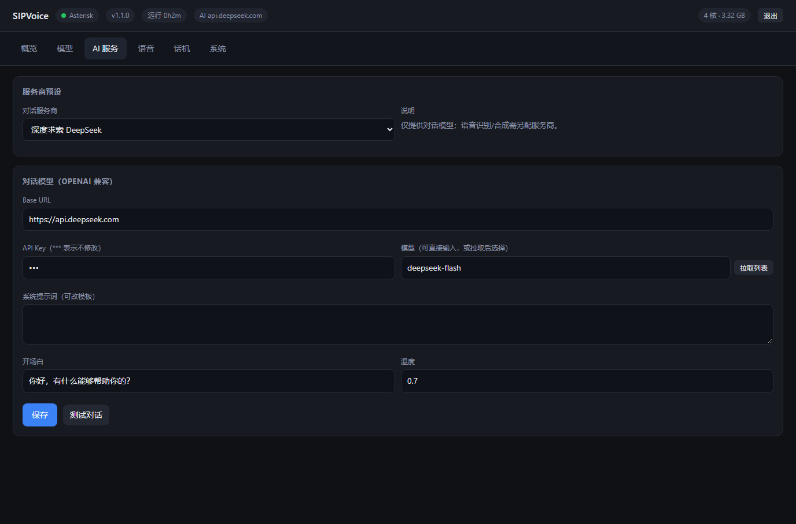
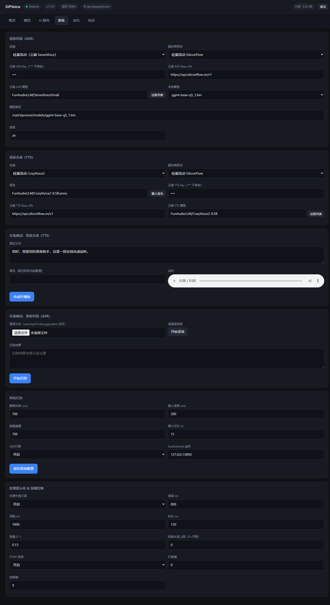

# SIPVoice · 轻量 SIP 语音 AI 网关


[English](README.md) · **简体中文**

把一通普通的电话变成和 AI 的对话：**话机 / 语音网关 → Asterisk → voicebridge → 任意大模型**。
不需要公网 IP、不需要厂商云、不需要平台月费，单个 Go 二进制跑在 2 核小机器上。

> ⚠️ **早期版本，使用前请先读**
>
> - 本项目**100% 由 AI 编写**（AI 编码助手在人类指导下完成），已在真实硬件和真实电话上验证，
>   但**没有**经过人类维护者逐行审查。
> - 处于**早期阶段**（v1.x）：接口、配置项、部署脚本都可能在不通知的情况下变化。
> - **请勿用于生产环境**，也不要用于任何涉及人身安全的场景；先用一台测试机或家里试用。
> - 按“现状”提供，不附带任何担保。你接入的电话号码、凭据与 AI 费用由你自行负责。

---

## 它是做什么的

- ☎️ **AI 接电话**：拨 `9000`，AI 接听、听你说话、回答，可以随时打断
- 🎙️ **两种语音链路**
  - 三段式：云端/本地 ASR → 对话模型 → TTS（三者可以各用各的服务商）
  - 端到端：Qwen-Omni-Realtime（WebSocket），音频直接进模型、边生成边回放，**首包约 0.5 秒**
- 🖥️ **Web 控制台**：服务商预设、在线拉取模型、TTS 试听、ASR 上传/录音识别、话机台账、系统监控
- 🔔 **告警推送**：ServerChan 转发微信（启动 / 云端失败 / 磁盘不足）
- 📠 传真收发（T.38 / G.711，落 TIFF，可转 PDF 下载）

## 架构

```
 ┌────────────┐   SIP/RTP    ┌───────────┐   AudioSocket   ┌──────────────┐
 │ 话机 /     │ ───────────► │ Asterisk  │ ──────────────► │ voicebridge  │
 │ 语音网关   │ ◄─────────── │    22     │ ◄────────────── │ (Go, 单文件) │
 └────────────┘              └───────────┘   PCMU 20 ms    └──────┬───────┘
                                                                  │ HTTPS / WSS
                                                         ┌────────▼────────┐
                                                         │ ASR / LLM / TTS │
                                                         │ 或 端到端语音模型 │
                                                         └─────────────────┘
```

- **Asterisk** 负责 SIP 信令、G.711 编解码与传真
- **voicebridge** 负责 VAD 断句、打断、DTMF、AI 调用与控制台
- 两者之间用 **AudioSocket**（TCP）传音频，不依赖任何外部媒体服务

## 环境要求

- Ubuntu 22.04 / 24.04 / 26.04 或 Debian 12+（systemd）
- 2 核 CPU、2 GB 内存、约 2 GB 磁盘
- 能访问你选的 AI 服务商（以及 apt 源，用于装依赖）
- 可选：SIP 话机（MicroSIP、Zoiper、实体话机）或 FXS 语音网关

## 快速开始

```bash
# 1. 拿到发布包（或自行编译，见下）
scp sipvoice-<版本>-linux-amd64.tar.gz user@主机:/tmp/
ssh user@主机
tar -xzf /tmp/sipvoice-<版本>-linux-amd64.tar.gz
cd sipvoice-<版本>

# 2. 一条命令安装（会自动装 asterisk / ffmpeg / curl）
sudo bash install.sh

# 3. 打开控制台，创建管理员账号，填服务商 Key
#    https://<主机IP>:8080
```

装完拨号：

| 号码 | 用途 |
|---|---|
| `9000` | 与 AI 对话 |
| `600` | 接收传真 |
| `1001` / `1002` | 测试分机（密码 `SipVoice1001` / `SipVoice1002`） |

> 首次登录后请立刻改掉默认分机密码：控制台 →「话机」→ 编辑。

## 截图

| AI 服务 | 语音与在线测试 |
|---|---|
|  |  |

## 配置

全部在控制台里改，保存即生效（写入 `/etc/sipvoice/config.json`，不需要重启）。

- **服务商**：DeepSeek、硅基流动、阿里百炼、OpenAI、Groq、智谱、Kimi、腾讯混元、火山方舟、
  本地 Ollama、自定义 OpenAI 兼容端点
- **模型**：可手填，也可点「拉取列表」用你的 Key 在线获取真实可用模型
- **端到端语音**：`realtime.enabled`，默认 `qwen3.5-omni-flash-realtime`
- **对话行为**：静音判停、能量阈值、最大句长、是否允许打断、处理提示音
- **按键**：`0` 打断播报，`9` 挂断（都可改）

最小配置示例：

```json
{
  "audio": { "listen": "127.0.0.1:9092" },
  "ai": {
    "base_url": "https://api.deepseek.com/v1",
    "api_key": "sk-...",
    "chat_model": "deepseek-flash",
    "asr_backend": "siliconflow",
    "tts_backend": "siliconflow"
  },
  "realtime": { "enabled": false },
  "agent": { "greeting": "你好，有什么能够帮助你的？" }
}
```

### 修改控制台端口（手动）

控制台默认监听 `0.0.0.0:8080`，这个值来自 systemd 单元里的 `-web` 参数，**面板里暂时没有对应输入框**。
用 drop-in 覆盖即可（重新运行 `install.sh` 不会覆盖它，因为脚本只重写主单元文件）：

```bash
sudo mkdir -p /etc/systemd/system/sipvoice.service.d
sudo tee /etc/systemd/system/sipvoice.service.d/web-port.conf >/dev/null <<'EOF'
[Service]
ExecStart=
ExecStart=/opt/sipvoice/voicebridge -mode agent -config /etc/sipvoice/config.json -web 0.0.0.0:9080
EOF
sudo systemctl daemon-reload
sudo systemctl restart sipvoice
```

注意：

- 只改变控制台端口；SIP（`5060/udp`）与 AudioSocket（`127.0.0.1:9092`）不受影响
- 证书绑定的是主机名而不是端口，不需要重新生成
- 如果你原本为 8080 开了防火墙，记得同步放行新端口
- 想改回默认值：删掉该 drop-in 文件后 `systemctl daemon-reload && systemctl restart sipvoice`

## Docker

一个镜像里同时包含 Asterisk 和 voicebridge。**强烈建议用 host 网络**——SIP 与 RTP 在 Docker NAT
后面需要额外调参。

```bash
docker run -d --name sipvoice --restart unless-stopped --network host \
  -v sipvoice-etc:/etc/sipvoice \
  -v sipvoice-models:/opt/sipvoice/models \
  ghcr.io/USER/sipvoice:latest
```

然后打开 `https://<主机IP>:8080` 创建管理员账号。

自己构建：

```bash
make linux-amd64
docker build -t sipvoice:1.3.0 .
# 国内网络可加：--build-arg APT_MIRROR=cn.archive.ubuntu.com
```

如果不能用 host 网络，就映射端口（Asterisk 可能需要额外的 NAT 设置）：

```bash
docker run -d --name sipvoice \
  -p 5060:5060/udp -p 10000-10100:10000-10100/udp -p 8080:8080 \
  -v sipvoice-etc:/etc/sipvoice sipvoice:1.3.0
```

| 卷 | 用途 |
|---|---|
| `/etc/sipvoice` | 配置、API Key、管理员账号、话机台账、TLS 证书 |
| `/opt/sipvoice/models` | 可选的本地 whisper 模型 |

`SIPVOICE_WEB` 环境变量可改控制台监听地址（默认 `0.0.0.0:8080`）。细节与排错见
[docs/DOCKER.md](docs/DOCKER.md)。

## 传真

面板「传真」页提供完整收发能力：

**接收**
- 拨打 **600** 即可收传真，支持 T.38（UDPTL 4000-4999）与 G.711 回退
- 收到的传真落在 /var/spool/asterisk/fax（数据盘），面板可预览每一页、下载原文件

**发送**
- 选一份存档传真 + 填目标分机，服务端主动呼叫并发送
- 发送前先播放一段**预生成的提示语音**（只合成一次，之后反复使用，不重复计费）：
  > 感谢接听，这是 AI 下发的传真服务。请按传真机上的开始键接收。如果无法接收，请按 4 结束。
- 播完后等待用户按键，时长可调（默认 30 秒）；用户按 **4** 表示无法接收
- 发送结果（成功/失败、页数、速率）实时显示在面板上

**失败处理**
- 用户拒绝、呼叫失败、握手失败 → 传真自动归档到 /var/lib/sipvoice/fax-failed
- 同时发邮件通知，附件是自动转好的 **PDF**
- 每台分机可单独设收件邮箱，留空用全局默认

**邮局**
- 内置纯 Go 发信（不依赖 msmtp/sendmail），支持 SSL 465 / STARTTLS 587
- 主邮局 + 备用邮局，主用失败自动切换
- 面板「邮局设置」里填服务器、账号、授权码，可一键「发送测试邮件」
## 存储与日志

面板「存储」页可以直接改这些设置，改完点「保存并应用」即可生效（不用登服务器）：

| 设置项 | 说明 |
|---|---|
| 通话录音 | 开关。关掉后 9000 不再录音 |
| 录音目录 | 录音存放路径，默认数据盘 /data/recordings/monitor |
| 录音总量上限 | 默认 **5G**，超过后每 5 分钟从最旧的文件开始删，清到 90% 停止 |
| 单个日志上限 | 默认 **50M**，超过就切分 |
| 日志保留份数 | 默认 5 份，压缩后占用很小 |

页面上还会显示当前占用：录音文件数/大小、Asterisk 日志大小、磁盘可用空间，并提供
「立即清理录音」「立即轮转日志」两个按钮。

实现方式：面板把开关和目录写入 Asterisk AstDB（sipvoice/rec、sipvoice/rec_dir），
拨号方案在通话开始时读取；额度与日志规则写入 /etc/default/sipvoice-rec 和
/etc/logrotate.d/asterisk。没有独立数据盘时，录音落在 /var/lib/sipvoice/recordings。
## 从 1.x 升级

2.0 引入了四项不向后兼容的变更，升级前请先读一遍。

### 1. 密钥改为加密独立存储

1.x 的 API Key 明文存在 `/etc/sipvoice/config.json`；2.0 起移到
`/etc/sipvoice/secrets.json`，用 AES-256-GCM 加密（密钥由 `/etc/machine-id` 派生，
换机器无法解密），`config.json` 里只剩空串。

**升级后第一次在面板保存配置时，密钥会自动迁移过去。**
若你曾手工改过 `config.json`，建议升级后到「AI 服务」页重新填一次 Key，
并点一次「保存」确认迁移成功。

### 2. 新增系统依赖

| 依赖 | 用途 |
|---|---|
| `paps` + `ghostscript` | 文本渲染成 PDF（文本转传真） |
| `fonts-noto-cjk` | 中文渲染 |
| `libsox-fmt-mp3` | edge-tts 输出的 mp3 解码 |
| `python3-venv` | edge-tts 的安装环境 |

`upgrade.sh` 会自动补齐；手动部署需自行 `apt install`。

### 3. 目录权限

`/etc/sipvoice` 需要 `2770 root:sipvoice`。服务以 `sipvoice` 身份保存配置
（写临时文件再 rename），目录组不可写会报
`permission denied: /etc/sipvoice/xxx.json.tmp`。

`upgrade.sh` 会自动修正。

### 4. 传真文件名规则

接收的传真现在带主叫号码：`20261125-112812-1003.tiff`（原来是纯时间戳）。
如果你有按固定格式解析文件名的外部脚本，需要相应调整。

### 升级步骤

```bash
# 1. 下载新版本二进制
# 2. 用 upgrade.sh 升级（自动备份、自动回滚、自动补依赖）
sudo ./upgrade.sh ./voicebridge

# 升级失败会自动回滚到上一版本
sudo ./upgrade.sh --rollback

# 查看可用备份
sudo ./upgrade.sh --list
```

## 运维

```bash
sudo bash install.sh                 # 幂等安装（干净系统约 40 秒）
sudo bash upgrade.sh <新二进制>       # 升级，失败自动回滚
sudo bash upgrade.sh --rollback       # 回滚上一个版本
sudo bash uninstall.sh [--purge]      # 卸载（--purge 连配置一起删）
systemctl status sipvoice
journalctl -u sipvoice -f
```

## 从源码编译

需要 Go 1.24+。代码是**纯 Go**：没有 cgo、没有汇编、没有第三方模块。

```bash
git clone https://github.com/USER/sipvoice.git && cd sipvoice
make build            # 本机架构
make release          # 生成 linux/amd64 与 linux/arm64 发布包（dist/release/）
go test ./...
```

### 其他架构（ARMv7、MIPS、RISC-V……）

因为没有架构相关代码，任何 Go 支持的 Linux 目标都可以自行交叉编译：

```bash
# 32 位 ARM（树莓派 2/Zero、路由器）
GOOS=linux GOARCH=arm GOARM=7 CGO_ENABLED=0 go build -trimpath -ldflags "-s -w" \
  -o voicebridge-linux-armv7 ./cmd/voicebridge

# 小端 MIPS（大量路由器 / NAS 使用）
GOOS=linux GOARCH=mipsle GOMIPS=softfloat CGO_ENABLED=0 go build -trimpath -ldflags "-s -w" \
  -o voicebridge-linux-mipsle ./cmd/voicebridge

# RISC-V 64
GOOS=linux GOARCH=riscv64 CGO_ENABLED=0 go build -trimpath -ldflags "-s -w" \
  -o voicebridge-linux-riscv64 ./cmd/voicebridge
```

可用的 `GOARCH` 包括 `amd64`、`arm64`、`arm`、`386`、`mips`、`mipsle`、`mips64le`、`ppc64le`、
`riscv64`、`s390x`、`loong64`。

冷门平台的注意点：你仍然需要该架构的 **Asterisk** 与 **ffmpeg**（发行版提供或自行编译），
安装脚本只认 `apt`。官方测试过的目标是 `linux/amd64` 与 `linux/arm64`。

## 目录结构

```
cmd/voicebridge/     程序入口（server / agent / calltest / doctor / mockai 模式）
internal/
  audiosock/         AudioSocket 协议与连接
  voice/             VAD 断句、打断、回合编排
  omni/              端到端语音会话（Qwen-Omni-Realtime）
  ws/                自研 WebSocket 客户端（零第三方依赖）
  adapters/          云端 ASR/TTS/对话、本地 whisper、模型列表
  webui/             内嵌控制台与 REST API
  phones/            话机台账，生成 Asterisk 配置
  auth/ config/ models/ media/ netutil/ sysinfo/ ...
deploy/              安装 / 升级 / 卸载脚本与 Asterisk 基线配置
docs/                截图与发布流程
```

## 常见问题

| 现象 | 排查方向 |
|---|---|
| 控制台打不开 | `systemctl status sipvoice`；自签证书需要在浏览器里手动信任一次 |
| 话机注册成功但 AI 不说话 | `journalctl -u sipvoice -f`；检查服务商 Key 与模型名 |
| 重启后分机消失 | 已由 systemd drop-in 自动 `pjsip reload`；可 `asterisk -rx "pjsip show endpoints"` 确认 |
| 完全没有声音 | `ss -lntp` 应有 `127.0.0.1:9092`；Asterisk 需能连到 AudioSocket |

## 路线图

- [x] SIP 信令、AudioSocket 媒体桥、VAD/打断
- [x] 三段式与端到端语音、Web 控制台、一键部署
- [x] 服务商预设、在线模型列表、TTS/ASR 在线测试、告警推送
- [x] 传真收发：T.38 / G.711、提示音、DTMF 控制、失败归档、邮件通知
- [x] 异步会话：按主叫号码保留上下文，AI 可主动发传真 / 回拨
- [x] 传真与图片的视觉分析，结果写入会话与传真记录
- [x] `.deb` 安装包、Docker 镜像
- [ ] **绘图能力（多模型协作）** —— 见下
- [ ] 传真内容结构化提取（金额、日期、合同编号入库）
- [ ] 多文档合并成一份传真发出
- [ ] 更多端到端语音服务商

### 绘图能力（多模型协作）

目前接入的视觉模型（通义千问 Qwen-VL 系列）只负责**理解**图片，不具备生成图片的能力；
主流服务商也还没有「既能识图、又能绘图」的单一模型。

计划的做法的**在面板里分开配置两个模型**：

| 角色 | 模型示例 | 用途 |
|---|---|---|
| 对话 / 视觉理解 | `qwen3-vl-plus`（百炼） | 日常对话、读取传真与图片内容 |
| 图像生成 | Kolors 系列（硅基流动） | 根据描述生成图片 |

AI 用指令标记表达意图，系统按标记分派：

```
[DRAW:描述]            → 调绘图模型生成图片（待实现）
[FAXTEXT:号码:文本]    → 文本渲染成 PDF 再转传真（已实现）
[FAX:号码:文件名]      → 把存档里的传真原样发出（已实现）
[CALLBACK:要说的话]    → 按策略主动回拨（已实现）
```

生成的图片可再走传真链路发出去（TIFF / PDF 均已支持）。

## 参与贡献

欢迎提 Issue 和 PR，请先看 [CONTRIBUTING.md](CONTRIBUTING.md)。
考虑到代码由 AI 生成，任何人工审查与实测反馈都特别有价值。

## 许可

MIT，见 [LICENSE](LICENSE)。

运行时依赖（Asterisk、ffmpeg、whisper.cpp、各家云 API）**未随本项目分发**，
它们的许可证与使用方式见 [THIRD_PARTY_NOTICES.md](THIRD_PARTY_NOTICES.md)。
